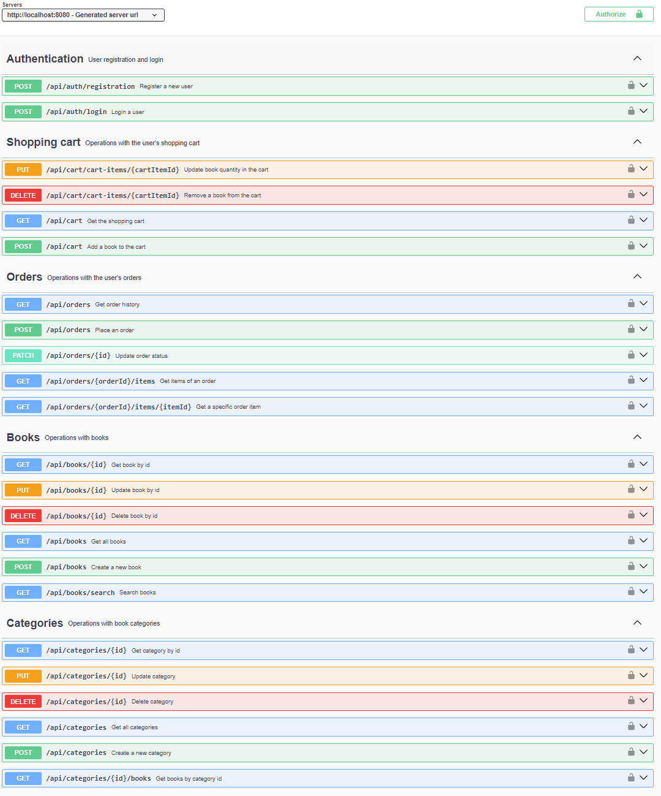
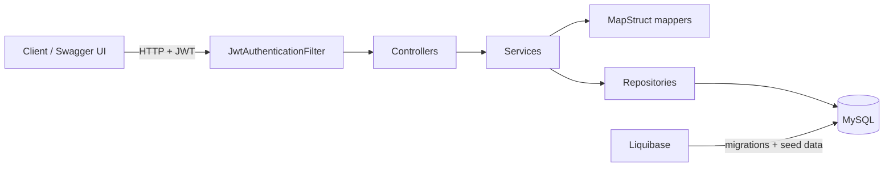

# Book Store API

A RESTful backend for an online book store, built with Spring Boot. Customers browse and search a catalog, fill a shopping cart and place orders; administrators manage books, categories and order statuses.

I built this project to practise how a real backend service is put together end to end: a layered architecture, stateless JWT security, database migrations, automated tests, CI and a containerised deployment to the cloud. It was developed incrementally through a pull-request workflow with mentor code reviews.

## Live Demo

The API is deployed on AWS EC2 and can be tried right away in Swagger UI:

http://56.228.31.17:8088/swagger-ui/index.html

| Role  | Email               | Password      |
|-------|---------------------|---------------|
| Admin | `admin@example.com` | `password123` |
| User  | register your own via `POST /api/auth/registration` | |

How to try it:
1. Call `POST /api/auth/login` with the credentials above and copy the `token` from the response.
2. Click **Authorize** (top right) and paste the token.
3. Call any endpoint. The database is pre-seeded with **20 books in 5 categories**.

> This is a public demo instance, so other visitors may change the data.

##  Screenshot



##  Features

- **JWT authentication & authorization**: stateless sessions, BCrypt password hashing, role-based access (`ROLE_USER`, `ROLE_ADMIN`) enforced with `@PreAuthorize`. Unauthenticated requests get `401`, authenticated users without the required role get `403`.
- **Book catalog**: full CRUD with pagination and filtered search by title, author and ISBN using JPA Specifications.
- **Categories**: CRUD with a many-to-many relationship to books and listing of books by category.
- **Shopping cart**: created lazily for each user; add, update and remove items.
- **Orders**: place an order from the cart, view order history and order items; admins update order status. Ownership checks ensure users only see their own orders, and invalid status transitions return `409 Conflict`.
- **Soft delete**: records are flagged instead of removed (Hibernate `@SQLDelete`).
- **DTO mapping** with MapStruct keeps entities and API contracts separate.
- **Validation**: Bean Validation on all requests plus a custom `@FieldMatch` validator for password confirmation.
- **Global exception handling**: structured JSON errors (timestamp, status, path, errors).
- **Database migrations** with Liquibase, including a seed changeset with demo data.
- **N+1 prevention** with `@EntityGraph` on repository queries.
- **Tests**: unit tests (JUnit 5, Mockito) and integration tests on a real MySQL via Testcontainers.
- **CI**: GitHub Actions runs Checkstyle, build and tests on every push and pull request.
- **Docker**: multi-stage Dockerfile and `docker-compose` with a MySQL healthcheck.

## Tech Stack

| Area        | Technology                                      |
|-------------|-------------------------------------------------|
| Language    | Java 17                                         |
| Framework   | Spring Boot 3.3.5 (Web, Data JPA, Security, Validation) |
| Auth        | Spring Security + JWT (jjwt 0.11.5)             |
| Persistence | MySQL 8, Hibernate / JPA, Liquibase             |
| Mapping     | MapStruct                                       |
| Docs        | springdoc-openapi (Swagger UI)                  |
| Testing     | JUnit 5, Mockito, Spring Security Test, Testcontainers |
| Build       | Maven, Checkstyle                               |
| DevOps      | Docker, Docker Compose, GitHub Actions, AWS EC2 |

## Architecture



Deployment: GitHub → EC2 (`git pull`) → `docker compose up --build` → app container (Spring Boot) + MySQL container.

##  Getting Started

### Option 1: Docker (recommended)

Prerequisites: Docker and Docker Compose.

```bash
git clone https://github.com/AliakseiS97/book-store-spring-boot.git
cd book-store-spring-boot
cp .env.sample .env        # fill in your own values
docker compose up --build
```

- API: `http://localhost:8088`
- Swagger UI: `http://localhost:8088/swagger-ui/index.html`
- MySQL from the host: `localhost:3307`

Liquibase creates the schema and loads demo data on the first start.

### Option 2: Run locally with Maven

Prerequisites: Java 17+, Maven 3.9+, a running MySQL 8 instance.

Set the datasource in `application.properties` (or via `SPRING_DATASOURCE_*` environment variables) and provide `JWT_SECRET` and `JWT_EXPIRATION`, then:

```bash
./mvnw spring-boot:run
```

The API starts on `http://localhost:8080`.

### Environment variables (`.env`)

| Variable | Description |
|----------|-------------|
| `MYSQLDB_DATABASE`, `MYSQLDB_USER`, `MYSQLDB_PASSWORD`, `MYSQLDB_ROOT_PASSWORD` | MySQL credentials |
| `MYSQLDB_LOCAL_PORT` / `MYSQLDB_DOCKER_PORT` | MySQL port on the host / inside Docker |
| `SPRING_LOCAL_PORT` / `SPRING_DOCKER_PORT` | App port on the host / inside Docker |
| `JWT_SECRET` | Secret key for signing tokens |
| `JWT_EXPIRATION` | Token lifetime in milliseconds |

### Running tests

```bash
./mvnw verify
```

Integration tests start MySQL in a container via Testcontainers, so Docker must be running.

##  Authentication Flow

1. Register: `POST /api/auth/registration`
2. Log in: `POST /api/auth/login` → receive a JWT
3. Send the token on protected endpoints: `Authorization: Bearer <token>`

`JwtAuthenticationFilter` validates the token on every request, and `JwtUtil` handles generation, parsing and validation.

## API Endpoints

### Authentication: `/api/auth`
| Method | Endpoint        | Access | Description                 |
|--------|-----------------|--------|-----------------------------|
| POST   | `/registration` | Public | Register a new user         |
| POST   | `/login`        | Public | Authenticate, returns a JWT |

### Books: `/api/books`
| Method | Endpoint  | Access      | Description                                 |
|--------|-----------|-------------|---------------------------------------------|
| GET    | `/`       | USER, ADMIN | List all books (paginated)                  |
| GET    | `/{id}`   | USER, ADMIN | Get a book by id                            |
| GET    | `/search` | USER, ADMIN | Search by title / author / ISBN (paginated) |
| POST   | `/`       | ADMIN       | Create a book                               |
| PUT    | `/{id}`   | ADMIN       | Update a book                               |
| DELETE | `/{id}`   | ADMIN       | Soft-delete a book                          |

### Categories: `/api/categories`
| Method | Endpoint      | Access      | Description               |
|--------|---------------|-------------|---------------------------|
| GET    | `/`           | USER, ADMIN | List categories           |
| GET    | `/{id}`       | USER, ADMIN | Get a category            |
| GET    | `/{id}/books` | USER, ADMIN | List books in a category  |
| POST   | `/`           | ADMIN       | Create a category         |
| PUT    | `/{id}`       | ADMIN       | Update a category         |
| DELETE | `/{id}`       | ADMIN       | Soft-delete a category    |

### Shopping Cart: `/api/cart`
| Method | Endpoint                | Access | Description                     |
|--------|-------------------------|--------|---------------------------------|
| GET    | `/`                     | USER   | Get the current user's cart     |
| POST   | `/`                     | USER   | Add a book to the cart          |
| PUT    | `/cart-items/{cartItemId}` | USER | Update item quantity            |
| DELETE | `/cart-items/{cartItemId}` | USER | Remove an item from the cart    |

### Orders: `/api/orders`
| Method | Endpoint                       | Access | Description                         |
|--------|--------------------------------|--------|-------------------------------------|
| POST   | `/`                            | USER   | Place an order from the cart        |
| GET    | `/`                            | USER   | Get the current user's order history|
| GET    | `/{orderId}/items`             | USER   | Get items of an order               |
| GET    | `/{orderId}/items/{itemId}`    | USER   | Get a specific order item           |
| PATCH  | `/{id}`                        | ADMIN  | Update order status                 |

## Domain Model

- **Book**: title, author, ISBN (unique), price, description, cover image, soft-delete flag; many-to-many with Category.
- **Category**: name, description, soft-delete flag.
- **User**: email (unique), password, first/last name, shipping address; many-to-many with Role.
- **Role**: `ROLE_USER` / `ROLE_ADMIN`, implements `GrantedAuthority`.
- **ShoppingCart** / **CartItem**: one cart per user, items reference books with a quantity.
- **Order** / **OrderItem**: status, total, order date, shipping address; items store the price at the moment of purchase.

## Project Structure

```
src/main/java/mate/academy
├── config          # application configuration
├── controller      # REST controllers
├── dto             # request / response DTOs
├── exception       # global exception handler & custom exceptions
├── mapper          # MapStruct mappers
├── model           # JPA entities
├── repository      # Spring Data JPA repositories
├── security        # SecurityConfig, JwtUtil, JwtAuthenticationFilter
├── service         # business logic
├── specification   # JPA Specifications for book search
└── validation      # custom validators (@FieldMatch)
src/main/resources
└── db/changelog    # Liquibase migrations and seed data
```

## Postman Collection

A ready-to-use collection is in [`postman/book-store.postman_collection.json`](postman/book-store.postman_collection.json).

1. Import it into Postman.
2. Set the `baseUrl` variable (`http://localhost:8088` or the demo URL).
3. Run **Auth → Login**. The token is saved to the `token` variable and used by all other requests.

## Challenges & Solutions

- **Errors disguised as 403.** Any exception on a public endpoint (validation, bad credentials) was reported as `403 Forbidden`. Spring forwards errors to `/error`, which was not in `permitAll()`, so the real response was blocked. Opening `/error` and adding an `HttpStatusEntryPoint` made the API return correct statuses (`400`, `401`, `409`).
- **Changing migrations safely.** Editing an already applied Liquibase changeset breaks startup with a checksum error. I learned to treat applied changesets as immutable and to add new ones, including a separate seed changeset for demo data.
- **N+1 queries.** Loading books with categories and carts with items produced extra queries. I fixed this with `@EntityGraph` on repository methods.
- **Deploying to a 1 GB instance.** The multi-stage Docker build runs Maven on the server and ran out of memory on an EC2 `t3.micro`. Adding a swap file solved it without upgrading the instance.
- **A stuck database container.** The MySQL container stayed `unhealthy` after its process had died, and `depends_on: service_healthy` then blocked the app from starting. Reading the healthcheck log with `docker inspect` pointed to the cause, and restarting the container fixed it.
- **Docker build context.** The first image failed because `checkstyle.xml` was excluded from the build context and JWT variables were missing in the container. I fixed `.dockerignore` and passed the variables through `.env`.

## License

Built for learning and portfolio purposes.
