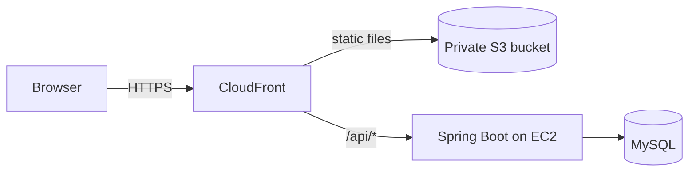

# Deployment

The frontend runs on a private S3 bucket behind CloudFront. The Spring Boot API and MySQL run on EC2.



The browser talks to one HTTPS address, so CORS stays off and there is no mixed-content problem.

## 1. Update the backend on EC2

Connect to the instance, then:

```bash
cd book-store-spring-boot
git pull
docker compose up -d --build app
```

Liquibase applies the new migration on startup. The `web` container is only for local runs and is not needed on EC2.

## 2. Publish the frontend

Open **AWS CloudShell** in the same region as the instance:

```bash
git clone https://github.com/AliakseiS97/book-store-spring-boot.git
cd book-store-spring-boot
bash deploy/deploy-frontend.sh
```

The first run takes several minutes while CloudFront is created. The script prints the shop URL at the end.
Run the same script again to publish later changes.

## Good to know

- The EC2 address must stay the same. Attach an Elastic IP, or update `ApiOriginDomain` in `deploy/cloudfront.yml` when it changes.
- Traffic between CloudFront and EC2 uses plain HTTP on port 8088. This is acceptable for a demo with test accounts only.
- Swagger UI stays available directly on the EC2 address.
- To remove the frontend, empty the bucket and delete the `book-store-frontend` CloudFormation stack.
